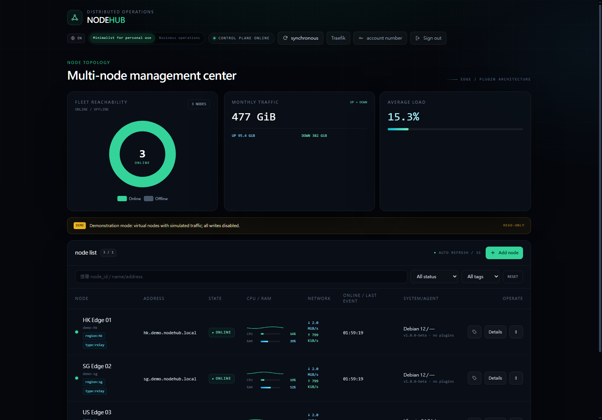
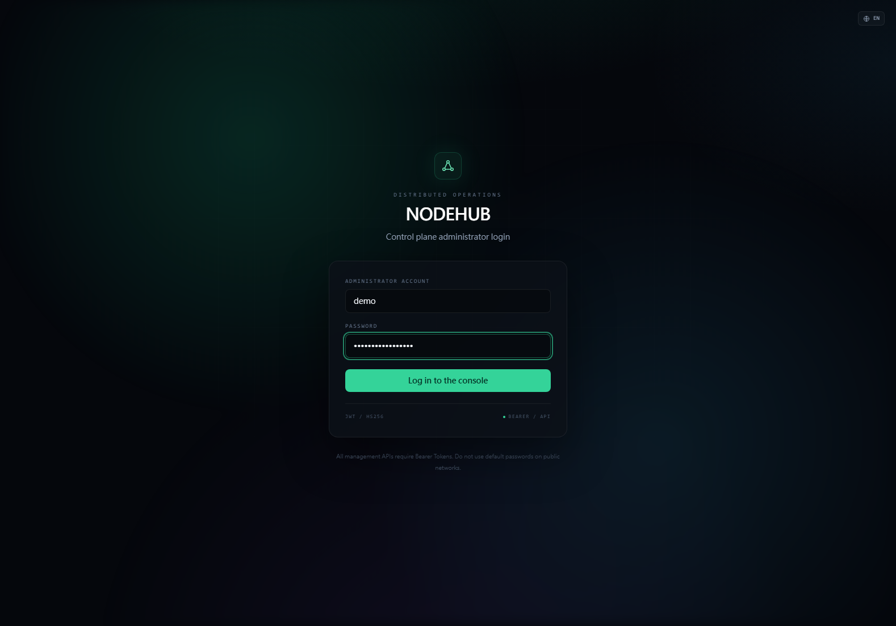
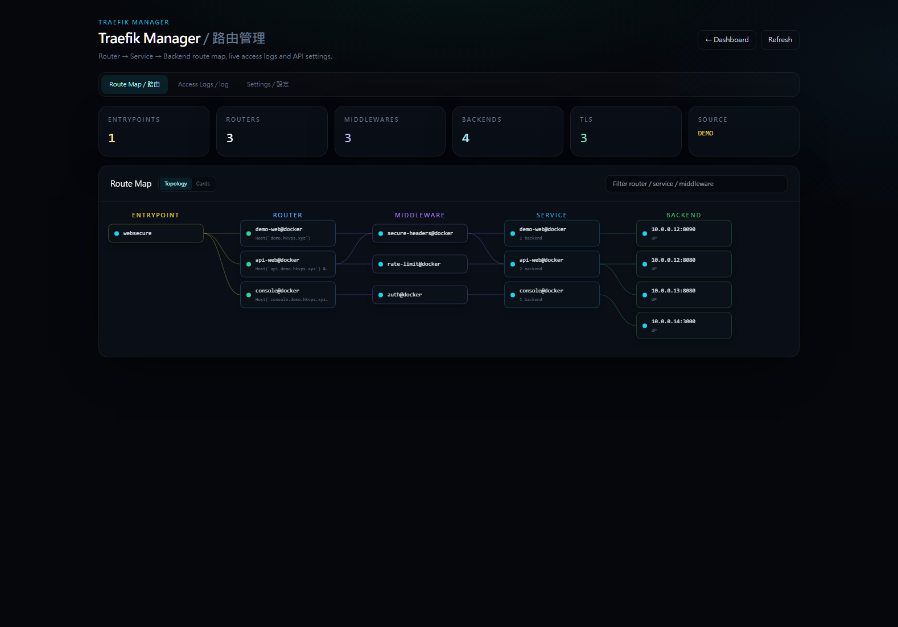
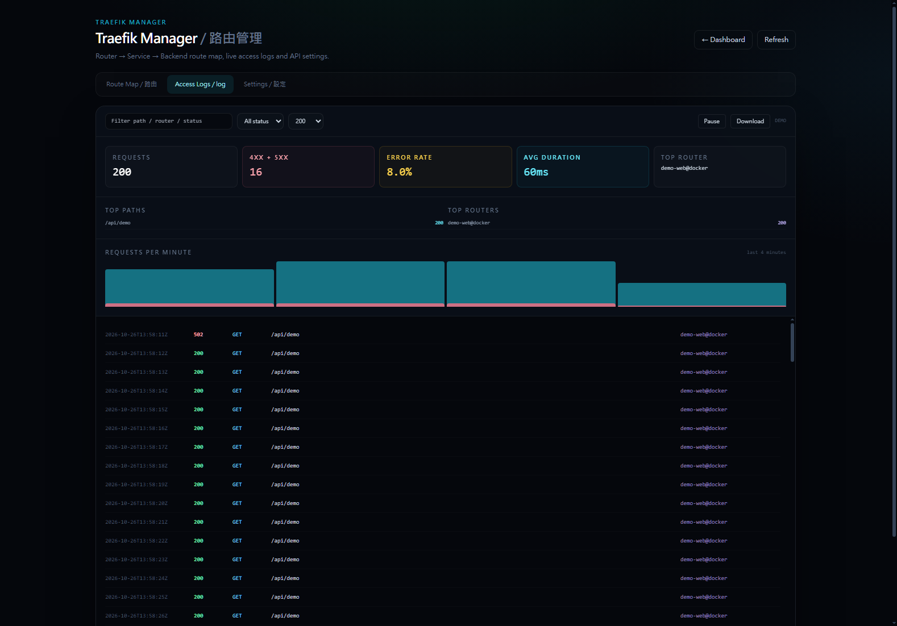

<div align="center">

# NodeHub

### 一個面板，管理所有機器，不用半夜救火。

輕量、自架的 Xray 節點、Traefik 路由與無人值守維運控制面。

[](https://github.com/NatShiftN/multi-node-hub/releases)
[](LICENSE)
[](https://go.dev)
[](https://vuejs.org)
[](Dockerfile)

[**線上 Demo**](https://demo.hkvps.xyz/) · [快速開始](#-快速開始) · [English](README.md) · [简体中文](README.zh-CN.md)



</div>

---

## NodeHub 是什麼？

NodeHub 是給「不只有一台伺服器」的人用的**單一控制面**。

不用再逐台 SSH 進去裝 Xray、改 Nginx/Traefik、看 CPU、換 IP、救被牆的節點；打開一個頁面就能：

- 看所有節點在線 / 離線
- 建立 Xray 入站、複製訂閱連結
- 看 CPU、RAM、流量、Access Log
- 推送憑證與偽裝站
- 安全地換被牆 IP
- 用視覺化 Route Map 管理 Traefik

適合 **homelab、小型主機商、私人代理節點**，不是給大型 SaaS 用的。

> **不用 Kubernetes、不用插件市場、不用學 40 分鐘。**
> 一個 binary、一個 SQLite、一個面板。

---

## 誰適合用？

| 你是… | NodeHub 幫你… |
|---|---|
| 管 2–50 台 VPS | 不用逐台登入 |
| 賣 Xray / VPN 服務 | 給用戶訂閱連結與流量配額 |
| 用 Traefik | 在一個頁面看路由與日誌 |
| 常被牆 | 用有防護網的 Auto-Heal，而不是盲目腳本 |
| 不熟 Linux | 複製一行指令就能裝 Agent |

---

## 先看 Demo

```text
https://demo.hkvps.xyz/
```

Demo 是唯讀的，內建三個虛擬節點、模擬流量、Traefik 範例路由與日誌。登入頁已自動填入帳密。

---

## 🚀 快速開始

### 方法 A：Docker 一鍵安裝（推薦）

需求：Linux、Docker、Docker Compose v2。

```sh
git clone https://github.com/NatShiftN/multi-node-hub.git && cd multi-node-hub && ./install.sh
```

安裝器會：

1. 建立 `.env`，自動產生 `AGENT_TOKEN`、`JWT_SECRET`、管理員密碼
2. 建置 image
3. 啟動 NodeHub（port 8080）
4. 印出網址與管理員密碼

打開：

```text
http://你的伺服器:8080
```

接著：

```text
Nodes → Add Node → 複製安裝指令
```

把指令貼到乾淨的 Debian/Ubuntu VPS，Agent 會自動回連，不需要手動改設定檔。

### 方法 B：手動 Docker Compose

```sh
cp .env.example .env
# 修改 AGENT_TOKEN、ADMIN_PASSWORD、JWT_SECRET、NODEHUB_PUBLIC_URL
docker compose up -d --build
```

### 方法 C：從原始碼建置

```sh
go build -trimpath -buildvcs=false -ldflags "-s -w" -o bin/nodehub-server ./server
go build -trimpath -buildvcs=false -ldflags "-s -w" -o bin/nodehub-agent ./agent
cd web && pnpm install && pnpm build && cd ..
./bin/nodehub-server --addr 127.0.0.1:8080 --token change-me \
  --public-url http://127.0.0.1:8080 --db nodehub.db \
  --web-dir web/dist --admin-password 'change-this-password'
```

---

## 介面預覽

### Simple 模式 — 新手只需要這些




### Traefik Manager — Route Map 與 Access Log





---

## ✨ 功能

### 節點管理

- 所有機器集中在一個面板
- 在線 / 離線 / 網路錯誤 / GFW 封鎖
- CPU、RAM、網路、Xray 流量
- 標籤、搜尋、分頁、手機卡片
- Simple / Pro 漸進式模式

### Xray

- VLESS / Trojan / Shadowsocks
- TCP / WebSocket / gRPC
- TLS、REALITY、UUID、密碼產生
- 分享連結、QR、訂閱
- 使用者流量、配額、封禁
- Xray 狀態與重啟

### 無人值守維運

- 海外 TCP 成功 + 國內多探針交叉驗證才 Auto-Heal
- 24 小時最多 2 次換 IP / 重建，SQLite 持久化
- Vultr 先建新機、拿到 IP 才刪舊機
- Orphan 自動重試清理
- ADSL / PPPoE 重撥
- iptables 端口轉發，本地狀態恢復
- 一鍵 DD 重裝系統

### Traefik Manager

- `EntryPoint → Router → Middleware → Service → Backend` 拓撲
- Backend 健康、TLS、Middleware 標記
- Access Log 分析：4xx/5xx、Error Rate、Duration、Top Paths/Routers、每分鐘圖
- 即時過濾、暫停、下載
- Traefik API / Basic Auth / Access Log 路徑設定

> 這是獨立實作，靈感來自 Traefik Manager，不是複製它的 GPL 原始碼。

### 安全

- TOTP 兩步驟驗證
- RBAC：SuperAdmin / Operator / Viewer
- API Keys、Audit Log
- Cloud Key、憑證私鑰、Telegram/Webhook 密鑰 AES-GCM 加密
- Release binary 使用 `-s -w -buildvcs=false`
- Demo 寫入 API 一律 403

### 多語言與手機

- 中文 / English 切換
- `?lang=en`、`?lang=zh`
- 手機節點卡片

---

## 架構

```text
瀏覽器 (Vue 3)
      │ HTTPS / JSON / SSE
NodeHub Server (Go)
SQLite · RBAC · Traefik API
      │ WebSocket
┌─────┼─────┐
Agent A   Agent B   Agent C
Xray      Xray      Xray
iptables  iptables  iptables
```

資料面留在節點。控制面掛掉時節點繼續運作；Agent 用指數退避重連，並從本地恢復 Xray / iptables。

---

## 系統需求

| 元件 | 需求 |
|---|---|
| Server | Linux / Windows / Docker，1 vCPU，512 MB RAM |
| Database | SQLite（內建） |
| Agent | Linux amd64 / arm64 |
| Browser | Chrome / Edge / Safari / Firefox |
| Optional | Traefik v2/v3 API + access log |

---

## 常用操作

### 新增第一台節點

1. `Nodes → Add Node`
2. 輸入主機與 root 密碼，或貼 SSH 私鑰
3. 可選自訂 SSH port
4. 複製產生的安裝指令，到 VPS 執行

### 建立訂閱

1. 節點 → Subscriptions
2. 新增 VLESS / Trojan / Shadowsocks
3. 複製分享連結或 QR
4. 傳給客戶端

### 接上 Traefik Manager

1. 開啟 Traefik API
2. `Traefik → Settings`
3. 填 API URL、Basic Auth、Access Log Path
4. 儲存後 Route Map / Logs 自動載入

### 重置資料庫

```sh
docker compose down
docker volume rm multi-node-hub_nodehub-data
docker compose up -d
```

---

## 安全檢查

- [ ] 修改 `ADMIN_PASSWORD`
- [ ] 使用隨機 `JWT_SECRET`（32+ 字元）並備份
- [ ] 修改 `AGENT_TOKEN`
- [ ] 面板放在 HTTPS 後面
- [ ] 防火牆限制 8080
- [ ] 不要 commit `.env`、`nodehub.db`、`backups/`、憑證
- [ ] 曾貼到聊天或日誌的憑證全部輪換

詳見 [SECURITY.md](SECURITY.md)。

---

## 開發

```sh
make test          # go test
make vet           # go vet
make build         # server + agent
cd web && pnpm dev # 前端 :5173
```

---

## FAQ

**不用 Docker 可以嗎？**  
可以，編譯 Go binary，`--web-dir` 指向 `web/dist`。

**NodeHub 會代理流量嗎？**  
不會。Xray 在節點上跑，NodeHub 只負責控制。

**Server 掛掉會怎樣？**  
節點繼續運作，Agent 會重連。

**可以商用嗎？**  
GPL-3.0 允許商用，但衍生發佈需遵守 GPL。

**一定要 Traefik 嗎？**  
不用，Traefik Manager 是選配。

---

## License

GPL-3.0，見 [LICENSE](LICENSE)。

<div align="center">

**如果 NodeHub 幫你省時間，幫我按個 ⭐**

[Live Demo](https://demo.hkvps.xyz/) · [Releases](https://github.com/NatShiftN/multi-node-hub/releases) · [Issues](https://github.com/NatShiftN/multi-node-hub/issues)

</div>
